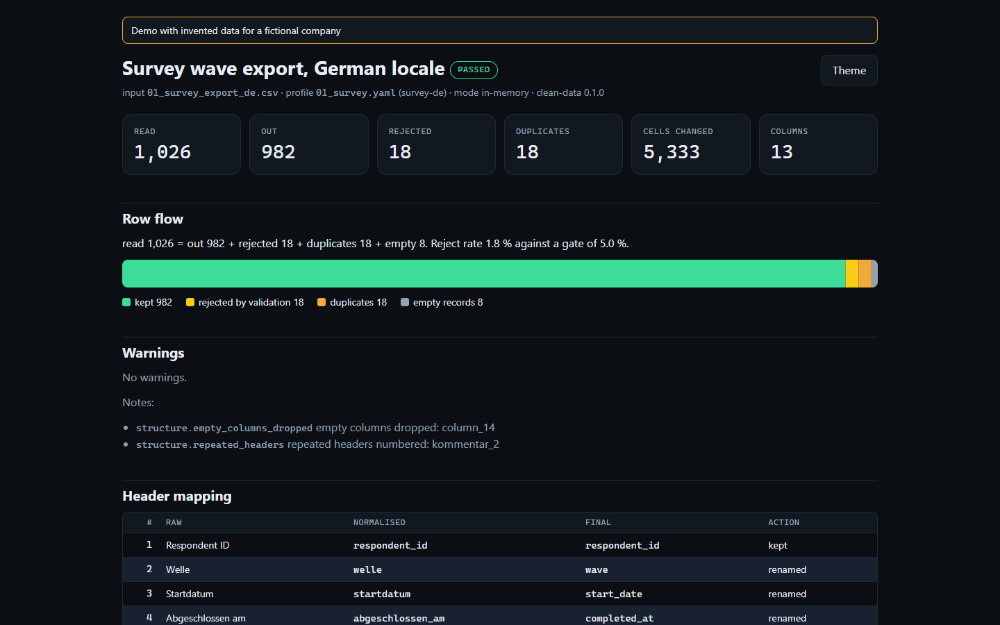
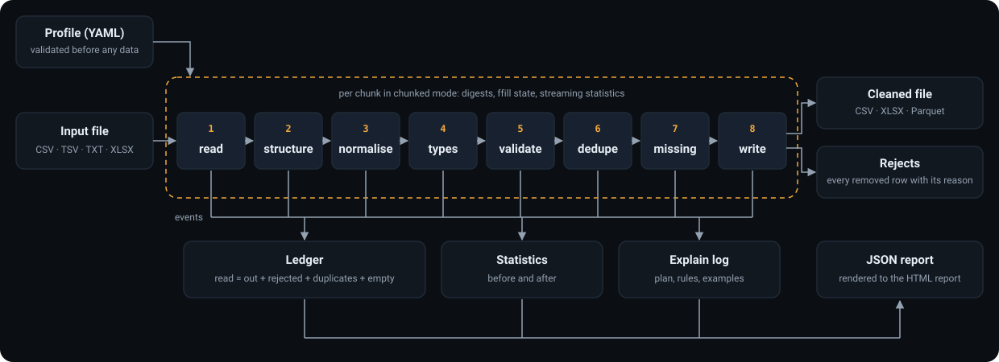

# Data-Cleaning Tool

[](https://github.com/HARISPAARTAN/data-cleaning-tool/actions/workflows/ci.yml)
[](https://harispaartan.github.io/data-cleaning-tool/)
[](https://github.com/HARISPAARTAN/data-cleaning-tool/releases)

Bereinigt unordentliche CSV- und Excel-Exporte reproduzierbar nach einem YAML-Profil, mit Ausschussdatei und HTML-Bericht.

English version: [README.md](README.md)

## Status

- Version 0.1.0. Befehle `profile`, `init` und `clean`; Eingabe CSV, TSV, TXT und XLSX; Ausgabe CSV, XLSX und Parquet (Extra `parquet`); unscharfe Dublettensuche als Extra `fuzzy`.
- Lokal geprüft unter Windows 11 mit Python 3.13 und den gesperrten Paketversionen: Die gesamte Testsuite läuft durch (Unit-, CLI-, Fixture-, Property- und Doku-Tests), die fünf Fixtures liefern genau die Ergebnisse aus [docs/data-model.md](docs/data-model.md), und Läufe des Fixtures mit 50.000 Datensätzen in Blöcken und im Speicher schreiben byte-gleiche Dateien.
- CI unter Ubuntu 24.04 und Windows Server 2025 mit Python 3.11, 3.12 und 3.13 ist noch nicht gelaufen; diese Zeile ändert sich, sobald sie gelaufen ist.

## Auftrag

> Wir sind ein Marktforschungspanel in Manchester. Jede Woche kommen Umfrageexporte aus unserer Umfrageplattform und Teilnehmendendateien von Partnerpanels als CSV und Excel an, und keine gleicht der anderen: Kommas oder Semikolons, deutsche oder englische Zahlenformate, drei Datumsformate in einer Spalte, seltsame Spaltennamen, dieselbe teilnehmende Person zweimal, Lücken, und das alte System eines Partnerpanels schickt noch Latin-1-Textdateien. Unser Analyseteam bereinigt sie von Hand in Excel, jede Person ein wenig anders. Wir wollen ein Werkzeug für die Kommandozeile auf Windows-Laptops und auf unserem Linux-Server, das eine Datei jedes Mal gleich bereinigt, nach einer Regeldatei, die wir bearbeiten können: Dubletten, fehlende Werte, Spaltennamen, Typen. Abgelehnte Zeilen sollen mit Grund in einer eigenen Datei landen, das Werkzeug soll sagen, was es geändert hat, und CSV, Excel oder Parquet exportieren. Manche Dateien sind zu groß für Excel.

Rebuilt from memory as a demo. The original client's name and data are not used. (Aus dem Gedächtnis als Demo nachgebaut; Name und Daten der ursprünglichen Auftraggeberschaft werden nicht verwendet.)

## Live-Demo

Die [Nutzungsseite](https://harispaartan.github.io/data-cleaning-tool/) zeigt einen aufgezeichneten Lauf auf dem Umfrage-Fixture: die vier Befehle mit ihrer Ausgabe, die ersten Datensätze vor und nach der Bereinigung und Links zum [HTML-Bericht](https://harispaartan.github.io/data-cleaning-tool/demo/report.html), zum JSON-Bericht, zum Profil, zur Eingabe und zu beiden Ausgabedateien.



## Was es kann

- **Liest Dateien jedes Mal gleich:** Kodierung (BOM, striktes UTF-8, dann Erkennung mit Warnung) und Trennzeichen werden erkannt, mehrzeilige Felder in Anführungszeichen, Kopfzeilen unter einem Titelblock, Fußzeilen, mehrere Excel-Blätter untereinander mit Blattspalte, zu kurze und fehlerhafte Datensätze.
- **Spaltennamen:** snake_case mit Umlauten, Währungszeichen und camelCase (`Haushaltseinkommen (€)` wird zu `haushaltseinkommen_eur`), doppelte Namen nummeriert, danach eine Umbenennungstabelle.
- **Text:** Unicode-Form, Steuer- und Nullbreitenzeichen, geschützte Leerzeichen, Leerraum, Platzhalter wie `k.A.`, Groß- und Kleinschreibung und Wertetabellen (`Deutschland`, `de` und `DE` werden zu `DE`).
- **Typen mit Gebietsschema:** deutsche und englische Zahlen (`45.000,00`, `1,250`), Datumswerte in mehreren Mustern, Zeitstempel und Wahrheitswerte; ein Wert, der sich nicht lesen lässt, wird abgelehnt und nie geraten.
- **Prüfregeln:** Pflichtfeld, Minimum, Maximum, regulärer Ausdruck auf den ganzen Wert und erlaubte Werte; jede fehlerhafte Zeile kommt mit allen Fehlern in die Ausschussdatei.
- **Dubletten:** exakt (nach der Normalisierung), nach Schlüssel mit „erste“ oder „letzte behalten“ und Sortierspalte, und unscharf innerhalb von Blöcken (Extra `fuzzy`, markiert Gruppen standardmäßig zur Prüfung).
- **Fehlende Werte je Spalte:** behalten, verwerfen, Konstante, Median (unterer Median bei ganzen Zahlen) oder Vorwärtsfüllen.
- **Berichte:** ein JSON-Bericht mit festen Schlüsseln und ein eigenständiger HTML-Bericht mit Statistiken vorher und nachher, Zeilenbilanz und Beispielen zu jeder Regel.
- **Blockmodus** für CSV-Dateien, die nicht in den Speicher passen, byte-gleich zu einem Lauf im Speicher, wo das Profil es erlaubt.
- **Ausgaben:** kanonisches CSV (gleiche Bytes unter Windows und Linux), XLSX mit fixierter Kopfzeile und Filtern, Parquet.

## Wie es funktioniert



Zuerst wird das Profil geprüft; dann laufen acht Stufen nacheinander: **read** (lesen), **structure** (leere Datensätze, Spaltennamen, Umbenennen und Weglassen), **normalise** (Text), **types** (Typen), **validate** (Prüfregeln), **dedupe** (Dubletten), **missing** (fehlende Werte) und **write** (schreiben). Jede Stufe ist eine reine Funktion von einem Frame auf einen Frame plus Ereignisse; die Ereignisse speisen die Zeilenbilanz (`read = out + rejected + duplicates + empty`, bei jedem Lauf geprüft), die Statistiken und das Erklärprotokoll. Die Normalisierung kommt vor der exakten Dublettensuche, damit Zeilen, die sich nur im Leerraum unterscheiden, Dubletten sind; die Prüfung kommt vor der Dublettensuche, damit `keep: last` nie einen ungültigen Datensatz vorzieht; fehlende Werte werden zuletzt aus den behaltenen Zeilen gefüllt ([ADR 0002](docs/adr/0002-stage-order.md)).

- `--dry-run` führt alle Stufen aus und schreibt nur die Berichte.
- `--strict` macht jede Ablehnung, die keine Dublette ist, und jede Warnung zu Exit 4, für geplante Läufe.
- `--explain` protokolliert den aufgelösten Plan und Beispiele zu jeder Regel auf stderr und nimmt sie in die Berichte auf.

Mehr in [docs/architecture.md](docs/architecture.md).

## Datenmodell

Ein Profil in Kurzform (das vollständige Umfrageprofil ist [profiles/01_survey.yaml](profiles/01_survey.yaml)):

```yaml
version: 1
name: survey-de
input: {encoding: utf-8-sig, delimiter: ";", locale: {decimal: ",", thousands: "."}}
headers: {rename: {alter: age}}
columns:
  respondent_id: {type: string, case: upper, required: true, regex: '^NG-\d{6}$'}
  age: {type: integer, min: 16, max: 99}
dedupe: {exact: true, keys: [{columns: [respondent_id], keep: last}]}
quality: {max_reject_rate: 0.05}
```

Jeder Schlüssel steht in der [Profilreferenz](docs/profile-reference.md) (englisch), und [docs/profile.schema.json](docs/profile.schema.json) liefert Editoren die Vervollständigung. Die Ausschussdatei enthält jede entfernte Zeile mit `_source_row`, `_source_sheet` (nur bei Excel-Eingabe), `_stage`, `_rule` und `_detail`, danach die Rohwerte wie gelesen; der JSON-Bericht ist Feld für Feld in [docs/report.md](docs/report.md) beschrieben. Fixtures, Ausschussspalten und Berichtsabschnitte: [docs/data-model.md](docs/data-model.md).

## Erste Schritte

Den Befehl mit [uv](https://docs.astral.sh/uv/) aus dem Release-Wheel installieren, mit Extras:

```bash
uv tool install "data-cleaning-tool[fuzzy,parquet] @ https://github.com/HARISPAARTAN/data-cleaning-tool/releases/download/v0.1.0/data_cleaning_tool-0.1.0-py3-none-any.whl"
```

Oder das Repository klonen, das auch die Fixtures und Profile enthält:

```bash
git clone https://github.com/HARISPAARTAN/data-cleaning-tool.git
cd data-cleaning-tool
uv sync --all-extras
```

Eine Datei ansehen, ein Profilgerüst schreiben, dann bereinigen (bash):

<!-- run exit=0 -->
```bash
uv run clean-data profile fixtures/01_survey_export_de.csv
uv run clean-data init fixtures/01_survey_export_de.csv --out my-survey.yaml
uv run clean-data clean fixtures/01_survey_export_de.csv --profile profiles/01_survey.yaml \
  --out out/cleaned.csv --rejects out/rejects.csv --report out/report.html --report out/report.json
```

Dasselbe in PowerShell:

<!-- run exit=0 -->
```powershell
uv run clean-data profile fixtures/01_survey_export_de.csv
uv run clean-data init fixtures/01_survey_export_de.csv --out my-survey.yaml
uv run clean-data clean fixtures/01_survey_export_de.csv --profile profiles/01_survey.yaml `
  --out out/cleaned.csv --rejects out/rejects.csv --report out/report.html --report out/report.json
```

Der letzte Befehl gibt `read 1026 · empty 8 · rejected 18 · duplicates 18 · out 982 · exit 0` aus. Die Tests laufen mit `uv run pytest`; die weiche Zeitprüfung am Fixture mit 50.000 Datensätzen gehört zu diesem Lauf und warnt nur. [docs/cli.md](docs/cli.md) beschreibt jede Option.

| Exit | Bedeutung |
|---|---|
| 0 | Erfolg |
| 1 | interner Fehler |
| 2 | Bedienungs- oder Profilfehler |
| 3 | Eingabefehler |
| 4 | Qualitätsschranke (`--strict` oder `quality.max_reject_rate`) |
| 5 | Ausgabefehler |
| 130 | abgebrochen |

## Aufbau des Repositorys

```text
src/cleandata/        das Paket: cli.py, core/ (ein Modul je Stufe), report/, skeleton/
profiles/             die Profile der fünf Fixtures
fixtures/             vier erzeugte Fixtures, ihre erwarteten Ergebnisse und MANIFEST.json
tests/                Unit-, CLI-, Fixture-, Property-, Doku- und Zeittests; Referenzausgaben
tools/                make_data.py, build_demo.py, export_schema.py, sync_kit.py und die Prüfungen
docs/                 Auftrag, Datenmodell, Architektur, Profilreferenz, CLI, Berichte, Übergabe, ADRs
web/                  die Pages-Seite: Nutzungsseite, Demo-Lauf, eingebundenes portfolio-kit
```

## Entscheidungen

- [ADR 0001: eigener CSV-Leser auf der Standardbibliothek](docs/adr/0001-own-csv-reader.md)
- [ADR 0002: Reihenfolge der Stufen](docs/adr/0002-stage-order.md)
- [ADR 0003: unscharfe Suche als Extra, standardmäßig markieren](docs/adr/0003-fuzzy-extra-flag-default.md)
- [ADR 0004: Parquet als Extra](docs/adr/0004-parquet-extra.md)
- [ADR 0005: Blockmodus mit Positivliste](docs/adr/0005-chunked-mode-allow-list.md)

## Verglichen mit der ursprünglichen Lieferung

Die ursprüngliche Arbeit war ein Bereinigungsskript je Datei der Auftraggeberschaft. Der Nachbau ergänzt einen schriftlichen Auftrag mit Abnahmekriterien, ein geprüftes Profilschema statt Codeänderungen je Datei, eine Ausschussdatei und Berichte zu jedem Lauf, Unit-, CLI-, Fixture- und Property-Tests, CI unter Windows und Linux, einen aufgezeichneten Demo-Lauf und eine Übergabedokumentation.

## Lizenz und Hinweis zu den Daten

MIT, siehe [LICENSE](LICENSE). Jedes Fixture erzeugt [tools/make_data.py](tools/make_data.py) mit festem Startwert: Vor- und Nachnamen werden zufällig aus kurzen Listen gängiger Namen je Land kombiniert ([tools/name_pool.py](tools/name_pool.py)), E-Mail-Adressen nutzen die reservierte Top-Level-Domain `.example`, und Northgate Panel Research ist ein erfundenes Unternehmen. Keine echte Person, kein echtes Unternehmen und keine echte Adresse kommt in diesem Repository vor.
